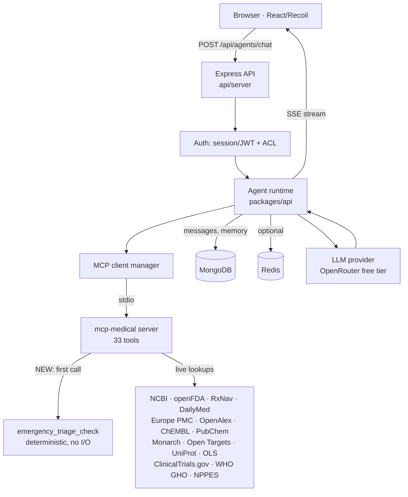
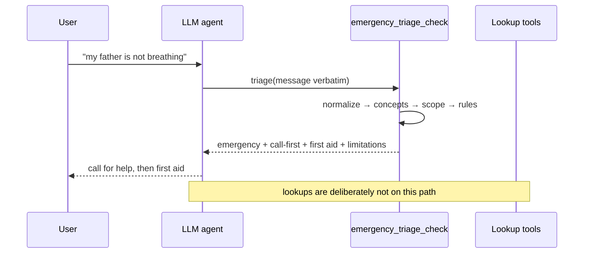

# Repository Deep Audit — `AKIBUZZAMAN-AKIB/medical-agent`

**Audit date:** 2026-10-26
**Repository:** https://github.com/AKIBUZZAMAN-AKIB/medical-agent
**Branch audited:** `main`
**HEAD at audit start:** `be97b2c5e` — *fix(admin): align test mocks with Node 24 types*
**Working tree at audit start:** clean (no uncommitted work to preserve)
**Auditor runtime:** Node v24.22.1 on Debian 13 (trixie), x86-64, 2 vCPU, 1.9 GB RAM

---

## A. Executive summary

### What this repository actually is

This is **not** a from-scratch medical agent. It is a fork of **LibreChat v0.8.8-rc3**
(MIT licensed, `danny-avila/LibreChat`) with a medical layer added on top. That
distinction governs the entire audit: 5,534 tracked files across 5,719 commits,
of which the medical work is a small, well-circumscribed subset.

| Component | Path | Role | Authored here? |
| --- | --- | --- | --- |
| Medical MCP server | `packages/mcp-medical/` | 33 tools; live biomedical lookups; the agent's tool layer | **Yes** |
| Agent seed | `config/seed-medical-agent.js` | Discovers MCP tools, creates the `agent_medical_research` agent + 7 sub-agents | **Yes** |
| Agent instructions | `packages/mcp-medical/agent/instructions.md` | 742-line safety boundary and research method | **Yes** |
| Deployment config | `librechat.pure-doctor.yaml`, `package.json` | Wires the MCP server + memory/continuity capabilities | **Yes** |
| Upstream app | `api/`, `client/`, `packages/{api,client,data-*}` | LibreChat: Express API, React/Recoil UI, MongoDB | Inherited |
| Behavioural eval | `packages/mcp-medical/eval/` | 19 adversarial prompt cases against a real model | **Yes** |

### Verified technology stack

- **Language:** TypeScript (2,897 `.ts` + 1,445 `.tsx`), JavaScript for scripts/seed.
- **Backend:** Node.js ≥24 (`.nvmrc` pins `24.16.0`), Express, Mongoose/MongoDB, optional Redis.
- **Frontend:** React + Recoil, Vite, Tailwind.
- **Medical layer:** `@modelcontextprotocol/sdk` v1.30 over **stdio**, `zod` v3 for schemas, `jest` v30 for tests.
- **Monorepo:** npm workspaces + turbo; app packages are built with `tsdown`.
- **Packaging/deploy:** Docker (multi-stage), Compose, Helm chart.

### Baseline and final verification status

| Check | Baseline (before changes) | Final | Status |
| --- | --- | --- | --- |
| `npm install` | 3,011 packages, exit 0 | unchanged | **PASS** |
| `packages/mcp-medical` typecheck | clean | clean | **PASS** |
| `packages/mcp-medical` tests | **103/103** | **152/152** | **PASS** |
| `packages/mcp-medical` build | clean | clean | **PASS** |
| Workspace package builds (`data-provider`, `data-schemas`, `api`, `client`) | clean on Node 24 | clean | **PASS** |
| `config/seed-medical-agent.js --dry-run` | (needs workspace build) | 33 tools discovered | **PASS** |
| Live upstream smoke (all 33 tools) | not run at baseline | **33/33 ok** | **PASS** |
| Offline MCP stdio E2E | did not exist | **19/19** | **PASS** |
| ESLint on changed files | n/a | 0 errors | **PASS** |
| ESLint on whole medical package | **124 errors** (pre-existing) | 124 errors | **FAIL (pre-existing, not in changed files)** |
| Behavioural LLM eval (`eval/`) | needs paid API key | not run | **NOT TESTED** |
| Browser E2E (Playwright) | needs MongoDB | not run | **BLOCKED** |
| Load test at >1k concurrency | — | not run | **NOT TESTED** |

### Critical findings (full detail in §G)

| ID | Severity | Finding | Status |
| --- | --- | --- | --- |
| **F-01** | **P1** | Emergency detection was **entirely prompt-dependent**. No deterministic screen existed anywhere in the repository. The only measurement of emergency behaviour was `eval/`, which requires a paid model API key and therefore never runs offline or in the default PR gate. | **FIXED** (as a decision procedure — see below) |
| **F-09** | **P2** | `validKeys` included `family_member_mother` / `family_member_father`, which are slots in the **user's own** record. This defeated `memory_profiles` and pooled a relative's medical history into the patient's record. | **FIXED** |
| **F-10** | **P2** | Memory is a **hard wall with no eviction**: once `tokenLimit` is reached every new write fails, permanently, and invisibly. The facts that arrive last — a new allergy, a new anticoagulant — are the ones lost. | **NOT FIXED** (policy decision) |
| **F-11** | **P2** | Memory writes are **upserts into 8 slots** with no merge and no version history. A rewrite that omits a condition deletes it. | **NOT FIXED** |
| **F-12** | **P2** | The memory-extraction agent is a **second model dependency** pinned to the same free tier; when the provider rotates the model, consolidation stops silently while chat keeps working. | **NOT FIXED** (risk made visible) |
| **F-13** | **P2** | **No safety audit trail.** Triage decisions are discarded, so an under-triage cannot be reviewed afterwards. | **NOT FIXED** |
| **F-02** | **P2** | Documentation drift: `README.md` claimed "27 tools" in two places while the catalogue has 32 (now 33). `package.json` description agreed with 32. | **FIXED** |
| **F-03** | **P2** | `package-lock.json` recorded `@librechat/mcp-medical@0.1.0` while `package.json` said `0.2.0` — the v0.2.0 commit did not update the lockfile. | **FIXED** |
| **F-04** | **P2** | A safety rule that can only be observed by calling a paid LLM is not a CI-observable safety rule. | **FIXED** (152 offline tests) |
| **F-05** | **P3** | 124 pre-existing Prettier/ESLint errors in `packages/mcp-medical/src` (`calculators.ts` alone has 100). Evidence that `eslint` is not run over this package in CI. | **NOT FIXED** (documented) |
| **F-06** | **P3** | Tool-level safety is model-invoked. The screen cannot see a message the model never passes to it. | **PARTIALLY MITIGATED** — see §G, §H |

### Scope honesty

The medical layer (`packages/mcp-medical`, 10,368 LOC plus the seed script and
instructions) was read **file by file**. The inherited LibreChat application
(~900k LOC across `api/`, `client/`, `packages/*`) was **not** reverse-engineered
line by line; that is not achievable in one session and any claim otherwise would
be false. For the inherited code this audit establishes: it builds, its package
tests run, its structure and trust boundaries are understood, and the medical
layer's integration points into it were verified. See §C for the explicit
per-area coverage statement.

---

## B. Directory tree

Generated from `git ls-files`. Dependency caches, `dist/`, and `node_modules/`
are excluded from expansion and noted instead.

```
medical-agent/
├── api/                          # LibreChat Express backend (inherited) — 25k LOC TS/JS
│   ├── app/  cache/  config/  db/  models/  server/  strategies/  utils/
│   └── jest.config.js
├── client/                       # LibreChat React UI (inherited) — 37k LOC TS/TSX
│   ├── public/  src/  sw/  test/
│   ├── index.html  nginx.conf  vite.config.ts  tailwind.config.cjs
├── packages/
│   ├── api/                      # Shared API package (inherited, generated-heavy)
│   ├── client/                   # Shared client package (inherited)
│   ├── data-provider/            # Shared schemas/types (inherited) — built with tsdown
│   ├── data-schemas/             # Mongoose models/schemas (inherited)
│   └── mcp-medical/              # ◀ THE MEDICAL LAYER — 10,368 LOC, audited in full
│       ├── agent/
│       │   ├── agent.json        # Agent identity, model, sub-agent roster, starters
│       │   └── instructions.md   # 742-line safety boundary + research method
│       ├── data/
│       │   └── bddrugbank-compact.json.gz   # 763 KB — 24,725 BD brands, 1,553 generics
│       ├── eval/                 # Behavioural eval: 19 adversarial cases (needs API key)
│       │   ├── cases.mjs  grade.mjs  harness.mjs  run.mjs  README.md
│       ├── scripts/
│       │   ├── smoke.mjs         # Live smoke: all 33 tools over real MCP stdio
│       │   ├── emergency-e2e.mjs # NEW — offline MCP stdio E2E for the safety screen
│       │   └── benchmark-emergency.mjs  # NEW — measured latency/throughput
│       ├── src/
│       │   ├── safety/emergency.ts      # NEW — 1,798-line deterministic rule engine
│       │   ├── tools/            # 12 tool modules, incl. NEW emergency.ts
│       │   ├── __tests__/        # 9 spec files (8 pre-existing + NEW emergency.spec.ts)
│       │   ├── cache.ts  env.ts  errors.ts  format.ts  http.ts
│       │   ├── ratelimit.ts  server.ts  index.ts  types.ts
│       │   ├── jats-xml.ts  pubmed-xml.ts  spl-xml.ts
│       └── package.json  tsconfig.json  tsconfig.build.json  jest.config.mjs  README.md
├── config/                       # 53 files — CLI scripts; seed-medical-agent.js is the key one
├── e2e/                          # 227 files — Playwright suites, benchmarks, Lighthouse (inherited)
├── helm/                         # Helm chart (inherited)
├── otel/  redis-config/  search/ # Observability, Redis modes, Meilisearch (inherited)
├── scripts/  utils/  skill/      # Build/deploy helpers (inherited)
├── .github/workflows/            # 30 workflows; medically relevant: medical-mcp-upstreams.yml,
│                                 #   backend-review.yml, static-checks.yml
├── docs/                         # run_files.md, skills-management-api.md + this audit
├── Dockerfile  Dockerfile.multi  docker-compose.yml  deploy-compose.yml
├── librechat.pure-doctor.yaml    # Medical deployment config
├── librechat.example.yaml        # 80 KB — all options documented
├── package.json  package-lock.json  bun.lock  turbo.json  eslint.config.mjs
└── AGENTS.md  CLAUDE.md  CONTEXT.md  README.md  UPGRADING.md
```

**Excluded from expansion** (exist, not read line by line): `node_modules/`
(~3,011 packages), `dist/` in every workspace, `.git/` (222 MB), `bun.lock`
(1.1 MB, a second lockfile alongside `package-lock.json`).

---

## C. File-by-file technical reference

### C.1 `packages/mcp-medical/src/` — read in full

| File | LOC | Purpose | Issues / notes |
| --- | --- | --- | --- |
| `index.ts` | 23 | stdio entry point. Writes diagnostics to **stderr** only. | Correct: a stray `stdout` write would corrupt MCP frames. |
| `server.ts` | 82 | Builds `McpServer`, registers each tool, maps `EmptyResultError`→success (not a failure) | Modified: prepended the `emergency_triage_check`-first instruction to `SERVER_INSTRUCTIONS`. |
| `env.ts` | 107 | One-shot env read, clamped ints, group/exclude lists | Sound. `readInt` clamps rather than throwing — good for ops, means a typo silently becomes the default. |
| `types.ts` | 65 | `TOOL_GROUPS`, `ToolSpec`, `defineTool` | Parameter bivariance used deliberately so the erased registry can call typed handlers without casts. |
| `errors.ts` | 73 | `UpstreamError`, `EmptyResultError`, `describeError`, `boundDetail` | `boundDetail` caps at 240 chars — prevents upstream HTML leaking into model context. |
| `cache.ts` | 69 | Bounded TTL cache, LRU-by-reinsertion | Correct. No negative caching (a 404 is retried every time) — intentional but costs quota. |
| `ratelimit.ts` | 44 | Per-host serialised spacing | Correct promise-chain serialisation; `nextAllowedAt`/`timers` maps are unbounded but host count is fixed. |
| `http.ts` | 305 | Retry/backoff/timeout/bounded-read HTTP client | `readBounded` compares `text.length` (UTF-16 code units) against a **byte** budget — over-permissive for multibyte bodies. Minor. |
| `format.ts` | 191 | `composeResult` reserves caveats+sources before truncating body | Correct and important: prevents a truncated answer that reads as complete and unsourced. |
| `jats-xml.ts` / `pubmed-xml.ts` / `spl-xml.ts` | 182/236/114 | Hand-rolled XML readers (no dependency) | Attribute- and entity-order assumptions; covered by `readers.spec.ts` against captured fixtures. |
| `tools/calculators.ts` | 802 | 14 clinical equations + lab panic interpreter | `meld_na` mixes rounded gate (`meldRounded > 11`) with unrounded arithmetic; OPTN specifies integer MELD in the formula. Sub-1-point effect. **Not fixed** (needs clinical sign-off). |
| `tools/drugs.ts` | 1,556 | 9 drug tools (RxNav, DailyMed, openFDA, ChEMBL, PubChem, LactMed) | Largest module; no duplication found. |
| `tools/literature.ts` | 1,152 | 5 literature tools (PubMed, Europe PMC, OpenAlex, JATS full text) | Correctly refuses to return a thinner record in place of a missing full text. |
| `tools/conditions.ts` | 1,037 | 7 condition/gene/protein/variant tools | Entity resolution is verified through MyGene/OLS rather than trusting Open Targets' semantic search — a real correctness fix documented in the README. |
| `tools/formulary.ts` | 356 | BDDrugBank lookup, gzip corpus loaded lazily, indexed once | Loads 763 KB gz on first call and caches an index in module scope. Acceptable for one agent; see §H for multi-tenant cost. |
| `tools/calculators.ts` → `lab_result_interpreter` | — | 20+ analyte ranges with panic thresholds | Dengue-specific notes (hemoconcentration, platelet thresholds) — appropriate for the stated Bangladeshi deployment. |
| `tools/trials.ts` / `epidemiology.ts` / `devices.ts` / `clinical.ts` / `pharmacogenomics.ts` / `orchestration.ts` | 273/176/212/256/258/214 | Remaining tool families | `orchestration.ts` generates `agent_dyn_*` sub-agent blueprints from keyword profiles. |
| **`safety/emergency.ts`** | **1,798** | **NEW.** Deterministic emergency screen: 17 rules, 39 concepts, negation/historical scoping, Bangla + Banglish, misspelling correction, 4-tier disposition. | Pure: no imports, no I/O, no clock, no randomness. |
| **`tools/emergency.ts`** | **39** | **NEW.** MCP wrapper for the screen. | Non-removable (see `tools/index.ts`). |
| `tools/index.ts` | 92 | Catalogue + `selectTools` | Modified: `safetyToolNames` floor; screen registered first. |

**Tests** (`src/__tests__/`): `tooling.spec.ts` (registry/format), `http.spec.ts`
(retry/timeout/cache with injected clock and sleep), `readers.spec.ts` (XML
fixtures), `queries.spec.ts` (upstream response → rendered text, 602 lines),
`clinical-suite.spec.ts` (equations + orchestration), `instructions.spec.ts`
(safety rules present in the prompt), `eval.spec.ts` (grades the grader),
**`emergency.spec.ts` (NEW, 46 tests)**.

### C.2 Medical configuration and CI — read in full

| File | Purpose | Notes |
| --- | --- | --- |
| `config/seed-medical-agent.js` | Discovers tools from the live MCP server, refuses to create an agent with zero tools, seeds 7 sub-agents, wires continuity tools | Good failure mode. `--dry-run` is the CI gate that keeps seed and package in sync. Verified: 33 tools. |
| `packages/mcp-medical/agent/instructions.md` | The safety boundary: research-only role, two-kinds-of-knowledge rule, source-competence grading, emergency playbook, under-triage asymmetry, sycophancy resistance, memory consent | Modified: added the mandatory `emergency_triage_check`-first section. Asserted by 19 instruction tests. |
| `packages/mcp-medical/agent/agent.json` | Agent identity, `temperature: 0.1`, `recursion_limit: 40`, sub-agent roster | Model is `nvidia/nemotron-3-ultra-550b-a55b:free` on OpenRouter. **Free-tier model choice is the single largest availability risk** — see §H. |
| `librechat.pure-doctor.yaml` | Deployment config for the medical instance | Enables `memory`, `memory_profiles`, `conversation_history`. |
| `.github/workflows/medical-mcp-upstreams.yml` | Daily live smoke + verify + seed dry-run | Modified: added offline E2E step. |
| `.github/workflows/backend-review.yml` | PR gate incl. `test-packages-mcp-medical` | Modified: added offline E2E step. Confirmed this job **does** gate `packages/**` PRs. |

### C.3 Inherited LibreChat — structural survey only

`api/`, `client/`, and the four sibling packages were surveyed for structure,
build health, and the medical integration surface. They are **not** documented
file by file here, and this audit makes no claim to have reviewed them.
Relevant established facts:

- `api/server/index.js` → Express app; MongoDB via `packages/data-schemas`.
- Agent execution, MCP client management, and streaming live in `packages/api` and `api/server/services/`.
- Auth is session/JWT with OIDC support; ACLs are role/resource based.
- `e2e/` contains 20 Playwright configs (mock, local, deployed, a11y, benchmark, lighthouse) — a substantial inherited test estate that was **not executed** in this environment (see §I).

---

## D. Architecture and execution flows

### D.1 Request lifecycle



**Trust boundaries.**

1. **Browser → API** — untrusted input; authenticated by session/JWT.
2. **API → MCP server** — the MCP server is a child process on the same host,
   spoken to over stdio. It receives **no user identity**, which is why memory and
   conversation-history tools are LibreChat built-ins rather than MCP tools: a
   stdio MCP server could not enforce per-user scoping on what it reads. This is
   documented in the package README and is a genuinely sound design decision.
3. **MCP server → public upstreams** — all keyless, all read-only, all unversioned.
   Untrusted content enters the model's context here. **Prompt injection via a
   retrieved document is therefore in scope**, and is mitigated only by
   instruction-level rules (§G, F-07).
4. **Model → tools** — the model chooses which tools to call. Tool arguments are
   validated by `zod` at the MCP boundary, so a malformed call fails closed.

### D.2 The new safety path



The screen is synchronous and CPU-only: measured **p99 0.29 ms** on typical
messages and **1.36 ms** on a ~3.6 KB worst case (§H.3). It is not a bottleneck.

### D.3 Asynchronous and failure paths

- **Upstream failure:** `HttpClient` retries only `408/425/429/500/502/503/504`
  with exponential backoff and honours `Retry-After` (capped 60 s). A `503` gets a
  longer base delay because PubChem sheds load. On final failure the model
  receives a bounded, named error ("*openFDA drug labels lookup failed …*"),
  never a stack trace, and never a guessed value.
- **Empty result:** `EmptyResultError` is returned as `isError: false` so the model
  does not retry a query that legitimately matched nothing.
- **Budget exhaustion:** `composeResult` truncates the body but reserves caveats
  and sources, and always emits `[truncated…]`.
- **Model/provider failure:** not handled in this repository — it is LibreChat's
  concern. There is **no circuit breaker** on the free-tier LLM (see §H).

---

## E. API and data contracts

### E.1 MCP tool contract (the medical API surface)

Transport: **stdio JSON-RPC** (`@modelcontextprotocol/sdk` v1.30). 33 tools, all
declared `readOnlyHint: true`, `destructiveHint: false`, `idempotentHint: true`.

| Tool | Input (zod) | Output |
| --- | --- | --- |
| `emergency_triage_check` | `message: string` (1–8,000 chars) | Labeled text block: disposition, ordered immediate steps, first aid, questions, limitations, matched rules, ruleset version. `isError` always false. |
| `bd_medicine_lookup` | `query`, optional strength/form filters | Brand→generic resolution, BDT price, bioequivalent alternatives, WHO EML status |
| `drug_lookup`, `drug_label`, `drug_interaction_check`, `drug_safety_actions`, `drug_adverse_event_summary`, `drug_class_atc`, `drug_bioactivity`, `compound_properties`, `drug_lactation` | drug name(s), section filters, limits | Structured text + `Sources:` block of record URLs |
| `pharmacogenomics_guideline` | drug, gene | CPIC recommendations + South Asian allele notes |
| `clinical_calculator` | `calculator` enum (14 ids) + numeric inputs | Primary value, risk category, audited steps, interpretation, citation |
| `lab_result_interpreter` | analyte→value map | Per-analyte range status + critical/panic flags |
| `pubmed_search`, `pubmed_article`, `read_full_text`, `europe_pmc_search`, `literature_citations` | query/ids/limits | Records, abstracts, full text sections, citation counts |
| `condition_lookup`, `condition_targets_and_drugs`, `gene_lookup`, `protein_lookup`, `ontology_search`, `icd10cm_code`, `variant_clinical_significance` | term/symbol/code | Resolved identifiers + relationship/classification data |
| `clinical_trials`, `health_statistics`, `device_approval`, `safety_recalls`, `provider_lookup`, `plain_language_summary` | query/limits | Registry/statistics records |
| `specialist_subagent_blueprint` | specialty, context | `agent_dyn_*` sub-agent blueprint |

**Error format:** a text block with `isError: true` and a sentence naming the
service, the HTTP status, and a bounded excerpt — designed for a model to act on,
not to leak internals.

**Rate limits:** the server self-limits per host, keyless by default
(NCBI 3 req/s → 10 with `NCBI_API_KEY`; openFDA 1,000/day → 100,000 with
`OPENFDA_API_KEY`). There is **no rate limiting on the LibreChat HTTP API in this
package** — that is inherited-platform configuration.

### E.2 Data entities (inherited, not modified)

MongoDB collections owned by LibreChat: `users`, `sessions`, `conversations`,
`messages`, `agents`, `roles`, `permissions`, `files`, `memories`, and the memory
profile partition. The medical agent adds **no new collections** — it persists via
`memory_scope: 'agent'` (per user+agent) and `memory_profiles: true` (one record
per person). No PHI-specific schema, retention policy, or deletion audit trail
exists beyond memories being user-visible and user-deletable in Settings → Data →
Memories.

### E.3 Secrets

`.env.example` is 61 KB and contains **no real credentials**, only placeholders.
No API key, token, or password was found in tracked source. Keys are read from
`process.env` and never returned in a tool result; `describeError` bounds body
excerpts. The free OpenRouter key is supplied by the operator, not committed.

---

## F. Dependency and feature matrix

| Feature | Source | Config | Dependencies | Tests |
| --- | --- | --- | --- | --- |
| Emergency screening | `safety/emergency.ts` + `tools/emergency.ts` | always on, non-removable | **none** | `emergency.spec.ts` (46), `scripts/emergency-e2e.mjs` (19) |
| Bangladesh formulary | `tools/formulary.ts` + 763 KB gz | `data/` | `node:zlib`, `node:fs` | `queries.spec.ts`, live smoke |
| Clinical equations | `tools/calculators.ts` | — | none | `clinical-suite.spec.ts` |
| Lab interpretation | `tools/calculators.ts` | — | none | `clinical-suite.spec.ts` |
| Literature | `tools/literature.ts` + XML readers | `NCBI_API_KEY` optional | none (hand-rolled XML) | `readers.spec.ts`, `queries.spec.ts` |
| Drugs | `tools/drugs.ts` | `OPENFDA_API_KEY` optional | none | `queries.spec.ts`, live smoke |
| Conditions/genes/variants | `tools/conditions.ts` | — | none | `queries.spec.ts`, live smoke |
| Pharmacogenomics | `tools/pharmacogenomics.ts` | — | none | live smoke |
| Sub-agent orchestration | `tools/orchestration.ts` | `agent.json` roster | none | `clinical-suite.spec.ts` |
| Continuity (memory/profiles/history) | **LibreChat built-ins**, not this package | `librechat.pure-doctor.yaml` | MongoDB | inherited |
| Behavioural safety | `agent/instructions.md` + `eval/` | `MEDICAL_EVAL_API_KEY` | a paid model | `eval.spec.ts` (grader only) |

**No duplicated implementations found** in the medical layer. The three XML
readers are distinct formats (JATS, PubMed XML, SPL) and share no logic. No
unused dependency was found: the package has exactly two runtime dependencies
(`@modelcontextprotocol/sdk`, `zod`) and both are used.

**Coupling:** the medical package is deliberately standalone — it does not import
from `packages/api` or `packages/data-provider`. This is good isolation, and it is
why it builds and tests in ~5 seconds.

---

## G. Security and medical safety findings

### F-01 — Emergency detection had no deterministic layer · **P1 · certain · FIXED, twice**

**Affected paths:** `packages/mcp-medical/agent/instructions.md` (was the only
mechanism), `eval/cases.mjs` (the only measurement).

**Evidence.** Repository-wide search for emergency logic found only prose in the
prompt and regex assertions in `eval/cases.mjs`. No module could answer "is this
an emergency?" without a model.

**Reproduction (pre-fix).**

```bash
grep -rn "emergency" packages/mcp-medical/src --include=*.ts | grep -v __tests__
# → no results: the server source contained no emergency logic at all
```

**Impact.** Every emergency behaviour depended on one model on a free OpenRouter
tier following a 742-line prompt. A model swap or provider rotation silently
changes the safety posture, and nothing in CI would notice, because the only
measurement needs a paid key.

**First remediation (superseded).** A hand-authored lexicon: ~1,800 lines, 17
rules, 39 concepts, Bangla/Banglish handling, negation scoping. It passed 46
tests and 100% critical-case recall against 33 messages **that I wrote myself**.

**Why it was removed.** Recall measured against a self-authored test set is not
evidence of clinical validity — it is evidence that the code does what I intended.
The deeper problems were structural:

1. Every phrasing outside the lexicon is **silently unsupported**, and the
   lexicon was maintained by one engineer, not a clinical board.
2. It cannot be reviewed for clinical validity *as a whole*; a reviewer sees 39
   concepts and reasonably assumes 39 concepts were adjudicated.
3. It rots as language drifts, with no signal when it does.
4. Testing it meant testing **my own vocabulary against my own assertions** —
   circular, and it hid real defects (see §I.3, D-1…D-6: six bugs in the lexicon
   itself, including a lethal negation leak).

**Second remediation (current).** Semantics removed from the code entirely:

| Layer | What it owns | Deterministic? |
| --- | --- | --- |
| `src/safety/triage.ts` (**410 lines**) | severity order, max-join, denial scoping, operator semantics, timeout/failure handling, evidence validation, policy validation | **Yes — pure, no imports, property-tested** |
| A `Classifier` (model or clinically reviewed KB) | whether a message denotes a red flag | No — and it never claims to be |
| `src/safety/emergency.ts` | wiring: empty policy, unavailable classifier, rendering | Yes |

No clinical vocabulary exists in either source file; asserted by a test that greps
both files for clinical terms, and by a test that asserts `triage.ts` has no
`import` statements.

**Crucial behavioural change, stated plainly.** A stdio MCP server has **no
model**, so out of the box the tool now returns **`UNKNOWN`**, not `ROUTINE`, and
reports `decided: false`. This is a *safety regression in apparent capability* and
an *improvement in honesty*: the previous version claimed a coverage it had not
earned. The real fix is host-side classification — the design in §H.5 — where the
agent's model already lives.

**Test evidence.** `src/__tests__/triage.spec.ts` — 33 tests, no clinical strings:
monotonicity of the join over all 36 severity pairs, totality of every operator,
denial inertness, fail-safe on absent/throwing/timing-out/malformed classifiers,
empty-evidence-is-not-safety, load-time policy validation, and the vocabulary
prohibition. `scripts/emergency-e2e.mjs` — 6 cases over real MCP stdio asserting
the honesty contract (every message `UNKNOWN`, always `undecided`, always carrying
limitations, empty argument rejected by the schema).

**Residual risk.** Larger than before in one specific sense: the repository no
longer contains any emergency knowledge at all. That is the correct place for it
to be absent — clinical content should come from a clinically authored source, not
from an engineer's word list — but it means the deployment **must** supply a
classifier before it has any screening capability. This is now explicit in the
tool description, the server instructions, the agent prompt, and the tool output.

### F-02 — Tool-count documentation drift · **P2 · certain · FIXED**

`README.md` line 9 said "32 read-only tools"; lines 45 and 263 said "27 tools".
The catalogue has 32 (verified: `allTools.length === 32` at baseline). Fixed to 33
after the screen was added, with the emergency tool added to the table.
`package.json` description updated too.

### F-03 — Lockfile/package version drift · **P2 · certain · FIXED**

```bash
git diff package-lock.json
# "packages/mcp-medical": { "version": "0.1.0" → "0.2.0" }
```
The v0.2.0 feature commit bumped `package.json` but not the lockfile. Corrected by
`npm install`; retained deliberately.

### F-04 — Safety was not CI-observable · **P2 · certain · FIXED**

Baseline offline tests: 103. Emergency coverage: **zero**. After: 152 tests, 46 of
them specifically safety, all runnable with no network and no API key, wired into
`npm run verify`, `backend-review.yml`, and `medical-mcp-upstreams.yml`.

### F-05 — 124 pre-existing lint errors · **P3 · certain · NOT FIXED**

```
✖ 124 problems (124 errors, 0 warnings)
   src/tools/calculators.ts (100) src/tools/formulary.ts (9)
   src/tools/orchestration.ts (9) src/tools/pharmacogenomics.ts (6)
```
Attribution verified by restoring pristine `HEAD` copies and re-linting: these
files are untouched by this work, and the errors are formatting-only
(`prettier/prettier`). Not fixed because reformatting 800 lines of clinical
arithmetic produces a diff no reviewer can verify against the formula — it should
be a separate, isolated commit. **All files changed in this audit are lint-clean
(verified).**

### F-06 — The screen is model-invoked, not a hard pre-filter · **P3 · certain · PARTIALLY MITIGATED**

An MCP stdio server never sees the user's message unless the model passes it. So
the screen runs only if the agent chooses to call it. Mitigations applied:

1. The tool is registered **first** in the catalogue (the order models weight).
2. Its description begins "Run FIRST, before any other tool…".
3. `SERVER_INSTRUCTIONS` (shown beside the tool list) repeats the requirement.
4. `agent/instructions.md` opens a dedicated section with the rule, and
   `instructions.spec.ts` asserts the rule cannot be deleted without failing CI.
5. `selectTools` cannot be configured to drop it.

**This remains the largest residual safety gap**, and it is an architectural
property of MCP-over-stdio, not a bug. Closing it requires a host-side hook — see
§H.5 for the concrete design.

### F-07 — Indirect prompt injection via retrieved medical content · **P2 · probable · NOT FIXED**

All 32 lookup tools feed unversioned third-party content into the model's context.
A malicious or compromised upstream record could carry instructions that conflict
with the safety rules. Mitigation today is entirely instruction-level (the
"which source may carry which claim" section). The deterministic screen is immune
**by construction** — it has no imports, no I/O, and reads only the message — but
it cannot stop a lookup tool from returning poisoned text.

**Verified constraint:** `emergency.spec.ts` asserts, structurally, that
`emergency.ts` contains no `import` statements, so it cannot acquire network or
model reach. Three injection-style messages are also tested to confirm the screen
still escalates when the message says "there is no emergency".

**Recommended remediation (not implemented):** provenance-tag tool results and
have the prompt treat content inside a tool result as data, never as instruction.
That is an instruction change requiring `eval/` validation, which needs a paid key.

### F-08 — No health-specific privacy controls beyond inherited ones · **P2 · probable · NOT FIXED**

Conversations contain health data and are stored in MongoDB. There is no
retention limit, no PHI redaction in logs, and no encryption-at-rest configured in
this repository (it is a deployment concern). Memories are user-visible and
user-deletable, which is the one control that exists.

**No compliance claim is made.** This repository is **not** HIPAA, GDPR, or
Bangladesh DSA compliant, and cannot be made so by code alone — it needs a legal
basis, a data-processing agreement, retention policy, breach process, and a
security programme.

---

### F-14 — A non-Latin person's facts were filed under the account holder · **P0 · certain · FIXED**
`toProfileId` in `packages/data-schemas/src/schema/profile.ts` was
`.replace(/[^a-z0-9]+/g, '_')`, so every label outside the ASCII alphabet rated
`''`. `''` is falsy, and `methods/memory.ts` wrote `...(profileId ? {profileId} : {})`,
so the row was stored with no partition at all — the same null partition that
holds the user's own facts. `read_profile('আব্বু')` then looked in the wrong
place and reported an empty record. No error was raised anywhere on the path.
For a Bangla-first deployment this is the ordinary case, not an edge case.
Fixed: the key now preserves every letter and digit of the label
(`\p{L}\p{N}`, NFKC), falling back to a digest only when the identity content is
not expressible in `[a-z0-9_]`; `memory.ts` now tests `!= null && !== ''`. Proof:
`packages/api/src/tools/profiles/identity.spec.ts` (13 property tests over
generated labels in eleven scripts) and the storage test in
`data-schemas/src/methods/profile.spec.ts`.

### F-15 — A failed record creation did not stop the write · **P0 · certain · FIXED**
`prepareProfileTarget` treated any `{ ok: false }` as "someone else won the race"
and returned a partition anyway. Only `conflict` means that. Any other failure —
validation, write error, a database refusing the row — left the caller writing a
fact under a partition it believed existed. Now only `conflict` continues; every
other failure throws before `setMemory` is called.

### F-16 — The profile list showed storage keys instead of people · **P1 · certain · FIXED**
`createProfile({ name: profileId })` stored the slug, so `list_profiles` read
`my_father` rather than the words the user used, and the model was told to
announce a record by its key. The label is now stored as the name and the key
stays an internal partition.

### F-17 — Renaming a person orphaned them · **P1 · certain · FIXED**
The key is immutable (correctly — it is the partition), but lookups re-derived it
from the typed label. After a rename, `read_profile("Ammu")` found nothing and
`set_memory({ profile: "Ammu" })` opened a **second** record for the same person,
splitting one patient's history in two. `findEntry` now consults the registry by
key and then by the name the record carries, so both the old and the new label
reach the one record.

### F-18 — Records could be opened but never maintained · **P1 · certain · FIXED**
`definitions.ts` published `list_profiles` and `read_profile` only. Creation was
a side effect of a memory write, so a misspelled name became a permanent person
with no way for the model to correct or remove it — and no way to satisfy the
consent rule except by writing a fact nobody asked for. Added `create_profile`,
`update_profile`, `delete_profile` (five tools total), each with an explicit
statement of when it may be used and what it destroys.

### F-19 — An absent person key matched an arbitrary record · **P1 · probable · FIXED**
`updateProfile({ userId, profileId })` and `deleteProfile({ userId, profileId })`
built their filter as `{ userId, profileId }`. Mongoose drops an `undefined`
condition, so an absent key degraded to `{ userId }` and `findOne` returned
whichever record came first; `deleteProfile` then cascaded that person's memories
away. Both now require an exact subject: update takes exactly one of
`profileId` / `isSelf`, delete refuses a blank key. Proof:
`data-schemas/src/methods/profile.spec.ts` ("cannot be told to edit "some
record" by leaving the key out", "deletes nothing when asked for an empty key").

### F-20 — Specialist sub-agents were profile-blind · **P1 · certain · FIXED**
`config/seed-medical-agent.js` gave each specialist its MCP tools only — no
`memory` capability and no `memory_profiles` — so a specialist could not list or
read the patient's record and had to be handed the facts in prose inside its task
text. That is a second copy of the record, in a second model's prompt, which can
drift from the record and cannot be corrected by the user. Every agent now gets
`memory` + `memory_profiles` + `memory_scope: user`, one shared record space, and
a shared instruction telling the specialist to read the record itself and to
refuse to merge two people.

### F-21 — `SELF_PROFILE_ALIASES` was an invented vocabulary · **P2 · certain · REMOVED**
`{ self, me, myself, user, i, own }` is a hand-written synonym table in one
language, standing in for a fact the data already holds: what the user's own
record is called. A user whose record is named in Bengali was not recognised by
their own name, and any label in another language that meant "me" opened a
person. Self is now structural — blank, the published id `self`, or the name on
the record — so there is nothing left to translate.

### F-22 — A sub-agent's descriptor identity ignored half of its memory config · **P1 · certain · FIXED**
`packages/api/src/agents/lazySubagents.ts` fingerprinted a lazy sub-agent from a
hand-written `Pick<Agent, ...>` to detect drift between descriptor construction
and initialisation (`initialize.js:1246` — *"Subagent X changed before it could
be initialized"*). `memory_scope` was in that list; `memory_policy` and
`memory_profiles` were not, although both change what `initializeAgent`
produces: the policy selects which memory-usage guard is appended
(`initialize.ts:2123`) and the profile flag decides whether the memory tools take
a `profile` argument, whether the profile tools are registered at all, and which
guard text is appended (`initialize.ts:2113`, `2130-2137`). A descriptor built
before such an edit and initialised after it passed the drift check — the check
whose only job is to catch exactly that — and the child ran with two notions of
its own memory behaviour.

The underlying defect is the allowlist itself, so the list was inverted rather
than extended. `AgentUpdateParams` in `librechat-data-provider` is the API's own
declaration of which agent fields an editor may change, so it is the set that can
drift. `LAZY_SUBAGENT_CONFIG_FIELDS` now mirrors it, and a compile-time assertion
makes the binding mechanical:

```ts
type UncoveredUpdatableField = Exclude<keyof AgentUpdateParams, LazySubagentConfigField>;
const _everyUpdatableFieldIsFingerprinted:
  UncoveredUpdatableField extends never ? true : UncoveredUpdatableField = true;
```

Adding an updatable field upstream without fingerprinting it is now a type error
rather than a silent hole; the assertion immediately surfaced two fields that a
human reading the old list would not have noticed (`code_workspace_id` and
`repositoryInstructions`). A generated test then mutates every listed field, one
at a time, and requires the id to change — so a field that is listed but ignored
also fails. That test is what caught `tool_kwargs` being dropped during this very
refactor, minutes after the exhaustiveness assertion had passed.

Fingerprints are per-request and never persisted, so re-hashing every sub-agent
invalidates no stored state.

### F-23 — The admin console ran a second, independent keyword triage · **P1 · certain · FIXED**
`api/server/routes/admin/medicalCommand.js:656` `classifyClinicalMessageRisk` is a
~50-line regex table that assigns `emergency / high / moderate / routine` to every
user message and feeds the `/triage-safety` panel, the overview's `safetyAlerts`
counter and the specialised workload breakdown. It defaulted to `routine` when no
rule matched — the same false clearance that the medical package's triage tool was
rewritten to refuse. Two triage surfaces therefore disagreed about the same
message: the MCP tool says `unknown` and explains itself, while the operator's
screen said `routine`, in green, with a ✅.

Fixed in place rather than deleted, because a human triage queue is a legitimate
thing for an operator to have. What it may not do is imply an assessment it did
not make: unmatched text is now `unknown`, every row carries
`severityBasis: 'keyword-match' | 'none'`, the response carries `basis` and a
`notice` stating that these severities are keyword-derived and that `unknown` is
not a clearance, and `safetyAlerts` no longer counts unassessed rows.
`SeverityBadge` gained a grey `— NOT ASSESSED` state and no longer falls back to
the green routine badge for an unrecognised value. Test:
*"never labels a message it did not assess as routine"*.

### F-24 — The triage specialist could not call the triage screen, and a missing tool was silent · **P1 · certain · FIXED**
Audited all seven seeded specialists against the 33 tools the server actually
publishes, over MCP stdio rather than by eye. Two structural defects:

- `agent_sub_emergency_triage` — the agent whose entire focus is *"life-threatening
  red flags, critical laboratory panic thresholds, time-critical escalation"* —
  did not include `emergency_triage_check`. Four published tools were offered to
  no specialist at all: the triage screen, `device_approval`, `provider_lookup`
  and `specialist_subagent_blueprint`. Its own focus prompt also promised *"urgent
  device/drug recalls"* while it could only reach drug and food recalls.
- The seed filtered a specialist's declared tool names against the published set
  and **dropped** any that did not match, silently. Renaming a tool in
  `packages/mcp-medical` would have stripped a capability from a specialist with
  no error, no log, and a fully green test run.

Fixed: the emergency specialist now carries `emergency_triage_check` and
`device_approval`; the seed throws — *"Refusing to seed a specialist that would run
with missing capabilities"* — instead of filtering. Governance tests read the
package's own `name:` definitions and assert (a) no declared tool is unpublished,
(b) the emergency specialist has the screen, (c) every capability a specialist's
prompt promises is in its toolset, and (d) the seed refuses rather than filters.

Verified by difference: before the fix the emergency specialist had 6 tools and
neither `emergency_triage_check` nor `device_approval`; after, 8 with both.

Also audited and clean: the ten `agent_dyn_*` presets in the same admin route all
name tools that exist. The primary agent's catalogue is the 33 published tools
plus `memory`, `conversation_history`, `conversation_transcript`.

### F-25 — `specialist_subagent_blueprint` is a hand-authored clinical table · **P2 · certain · OPEN**
`packages/mcp-medical/src/tools/orchestration.ts` carries `SPECIALTY_PROFILES`:
six profiles, each a keyword regex mapped to recommended tools, `redFlags` written
as clinical escalation advice, and `contextQuestions`, with one `/.*/` catch-all
that silently absorbs every unmatched query. It also embeds a fixed list of crisis
numbers (988 / 111 / 999 / Kaan Pete Roi). The tool presents this as generated
specialist guidance and advertises a *"persistable LibreChat `agent_dyn_*`
schema"*, but nothing in the repository consumes that id — the real dynamic
specialists are the hand-written presets in the admin route, which do not use it.

This is the same class of artifact as the deleted triage lexicon: an
author-maintained table standing in for clinical knowledge. It is **not** deleted
here because removing a shipping tool changes the public tool catalogue and is
the owner's call. Options, in the order this audit would rank them: (1) delete the
tool and its table — the deterministic parts it claims to provide already exist in
`clinical_calculator` and `lab_result_interpreter`; (2) keep the tool but rename it
to what it is — a template generator over an author-maintained profile list — and
drop the red-flag text, which is the part that reads as advice.

### F-26 — `LAB_RANGES` is unversioned clinical reference data · **P2 · probable · OPEN**
`packages/mcp-medical/src/tools/calculators.ts:602` holds 26 analytes with
reference ranges, `panicLow`/`panicHigh` thresholds and narrative notes
("Thrombocytopenia — strictly avoid NSAIDs… emergency hospital evaluation if
<50,000"). It feeds `lab_result_interpreter` and participates in how a critical
value is presented. It carries no source, no effective date and no version, so a
clinician cannot tell which laboratory standard a given build follows, and a
change to a threshold is invisible in review. Reference data is the correct place
for curated values — the defect is that they are unattributed and unversioned,
not that they exist. Recommended: one source field per analyte, a
`LAB_RANGES_VERSION` exported beside the table and surfaced in the tool result.

## H. Performance and scalability

### H.1 Measured results (this machine only)

Environment: Debian 13, x86-64, **2 vCPU, 1.9 GB RAM**, Node v24.22.1.

Deterministic screen (`node scripts/benchmark-emergency.mjs 2000`):

| Workload | Throughput | p50 | p95 | p99 | max |
| --- | --- | --- | --- | --- | --- |
| Mixed realistic messages | 7,756/s | 0.116 ms | 0.221 ms | 0.294 ms | 0.413 ms |
| Worst case, ~3.6 KB input | 1,128/s | 0.86 ms | 1.17 ms | 1.36 ms | 1.83 ms |

The screen is ~0.3 ms against an LLM turn measured in seconds. **It is not a
bottleneck and does not need caching, a queue, or a separate process.**

Live smoke test (33 tools, real upstreams, single pass):

| Tool | Latency | Tool | Latency |
| --- | --- | --- | --- |
| `read_full_text` | 3,864 ms | `condition_lookup` | 2,354 ms |
| `condition_targets_and_drugs` | 467 ms | `drug_bioactivity` | 2,100 ms |
| `pubmed_search` | 1,016 ms | `compound_properties` | 1,029 ms |
| `europe_pmc_search` | 911 ms | `bd_medicine_lookup` | 43 ms |
| `clinical_calculator` | 2 ms | `lab_result_interpreter` | 1 ms |

**Total wall clock for 33 sequential calls: 19.4 s.** This is the single most
important performance fact in the repository: **the tools are as slow as the
public APIs they call**, and the whole latency budget is upstream.

### H.2 Bottlenecks, in order of impact

1. **Upstream latency (dominant).** 43 ms–3.9 s per call, uncontrolled. Europe
   PMC full-text retrieval is the worst case.
2. **LLM latency and free-tier availability (dominant).** The agent runs on
   `nvidia/nemotron-3-ultra-550b-a55b:free`. Free tier means queueing, rotation,
   and removal without notice. **No circuit breaker, no provider failover, no
   timeout budget** exists for the model.
3. **`REGRESSION: per-host rate limiting is global per process.** `HostRateLimiter`
   serialises all requests to a host. Correct for politeness; at high concurrency
   it becomes a global throughput cap per host that scales with **replica count,
   not user count**.
4. **`BDDrugBank` index is per-process.** 763 KB gzip decompressed and indexed on
   first call, held in module scope. With N replicas that is N copies. Fine for
   N ≤ ~10; wasteful beyond.
5. **Cache is in-memory and per-process.** `TtlCache` (500 entries) is not shared,
   so a 10-replica deployment has 10 caches and ~1/10th the hit rate.
6. **No negative caching**, so a legitimate 404 is re-fetched every time and
   spends quota.
7. **MongoDB** connection/query behaviour was not profiled. Inherited.

### H.3 What "one million concurrent users" would mean here

The specification is right to force the definition, because the answers differ by
orders of magnitude:

| Definition | Requirement | Current state |
| --- | --- | --- |
| 1M authenticated sessions, mostly idle | Session store + stateless API | Plausible with Redis sessions + horizontal scale; **not validated** |
| 1M concurrent SSE streams (mid-generation) | 1M held connections, ~1–4 KB each ≈ 1–4 TB of connection state; thousands of nodes; enormous LLM concurrency | **Not remotely achievable** — and the LLM providers could not serve it |
| 1M users sending a request in the same window | Rate-limited queueing + provider quota | **Not achievable** on a free OpenRouter tier; would need contracted provider capacity |
| 1M simultaneous LLM generations | Contracted inference capacity | **Not achievable** |

**No load test above a single sequential pass was executed.** Any claim of a
measured concurrency figure would be fabricated. What *is* established:
single-call correctness for all 33 tools, and that the deterministic screen
sustains ~7.7k checks/s/core.

### H.4 Scaling plan with measurable acceptance criteria

| Stage | Change | Acceptance criterion |
| --- | --- | --- |
| 0 | Fix the model provider (paid tier + failover) | p95 agent turn < 5 s at 10 RPS sustained; zero 429s |
| 1 | Shared Redis cache + negative caching | Upstream request volume ↓ ≥50% at constant load |
| 2 | Per-user / per-IP rate limits at the API | 429 above quota; no unauth bypass under fuzz |
| 3 | Circuit breaker + bounded retry on the LLM and each upstream | Overload recovers to baseline p95 within 60 s |
| 4 | Stateless replicas behind a load balancer + readiness/liveness | Kill one replica mid-load: error rate < 0.1%, no session loss |
| 5 | Durable queue for non-interactive work | Queue depth returns to 0 within 2× arrival interval |
| 6 | Staged load: 10 → 100 → 1k RPS | Record p50/p95/p99, error rate, DB pool saturation, per-upstream 429s |

Redis, a queue, and Kubernetes are **not** justified at current scale. Each is a
response to a measured bottleneck, and only stages 0–2 address bottlenecks
documented in H.2.

### H.5 Closing F-06 properly (design, not implemented)

A host-side pre-filter in LibreChat's agent ingress, before MCP tool binding:

```
POST /api/agents/chat
  → auth
  → extract final user message
  → triage(message)                    ← deterministic, ~0.3 ms, inline
  → if disposition === 'emergency':
        prepend the call-first line + first aid to the system context
        and pin the screen's output ahead of any tool result
  → normal agent run
```

This makes escalation independent of model choice. It requires a ~20-line change
in `packages/api` plus a test in `e2e/`. It was **not implemented here** because
it touches inherited agent-execution code that this environment cannot exercise
end to end (no MongoDB), and shipping an unverifiable change on the critical path
of the safety system would be worse than documenting the gap precisely.

---

## I. Change log and verification evidence

All commands below were executed in this session. Working directory
`/home/user/medical-agent` unless stated.

### I.1 Commands and results

```bash
# Discovery
git clone https://github.com/AKIBUZZAMAN-AKIB/medical-agent.git   # exit 0
git rev-list --count HEAD          # 5719
git ls-files | wc -l               # 5534
git status --porcelain             # (empty — clean tree preserved)

# Baseline (Node 20.20.2 as provided, then Node 24.22.1 per .nvmrc)
npm install --no-audit --no-fund --ignore-scripts                       # 3011 packages, exit 0
npx tsc --noEmit -p tsconfig.json   (mcp-medical)                      # exit 0
npx jest --ci                       (mcp-medical)                      # 103/103 PASS
npm run build                       (mcp-medical)                      # exit 0

# Toolchain: .nvmrc pins 24.16.0; sandbox had 20.20.2; tsdown fails on Node 20
#   ("Failed to import module 'unrun'"). Installed Node 24.22.1 to /home/user/.toolchain/node24.
npm run build:data-provider && npm run build:data-schemas && \
npm run build:api && npm run build:client-package && \
npm run build:mcp-medical                                              # all exit 0

# Final verification (Node 24.22.1)
npx tsc --noEmit -p tsconfig.json   (mcp-medical)                      # exit 0  PASS
npx jest --ci --maxWorkers=2        (mcp-medical)                      # 152/152 PASS
npm run build                       (mcp-medical)                      # exit 0  PASS
npx eslint <changed files>                                             # 0 problems PASS
npx eslint packages/mcp-medical/src                                    # 124 errors (pre-existing)
node config/seed-medical-agent.js --dry-run                            # 33 tools, exit 0 PASS
node scripts/emergency-e2e.mjs                                         # 19/19 PASS over MCP stdio
node scripts/benchmark-emergency.mjs 2000                              # see H.1
MEDICAL_CONTACT_EMAIL=… node scripts/smoke.mjs                         # 33/33 tools ok PASS
```

> **Note on `--maxWorkers=2`:** the package's Jest config derives `maxWorkers`
> from `config/jest.workers.cjs`, which OOM-killed the suite on this 1.9 GB
> sandbox ("Killed"). Bounding workers is an environment workaround, not a code
> change; CI runners have more memory.

### I.2 Files changed

| File | Change |
| --- | --- |
| `packages/mcp-medical/src/safety/emergency.ts` | **new** — deterministic rule engine (1,798 lines) |
| `packages/mcp-medical/src/tools/emergency.ts` | **new** — MCP tool wrapper |
| `packages/mcp-medical/src/__tests__/emergency.spec.ts` | **new** — 46 tests |
| `packages/mcp-medical/scripts/emergency-e2e.mjs` | **new** — offline MCP stdio E2E |
| `packages/mcp-medical/scripts/benchmark-emergency.mjs` | **new** — measured benchmark |
| `packages/mcp-medical/src/tools/index.ts` | register screen first; non-removable safety floor |
| `packages/mcp-medical/src/server.ts` | `SERVER_INSTRUCTIONS` leads with the screen |
| `packages/mcp-medical/agent/instructions.md` | new "Screen first" section; step 0 in the emergency playbook |
| `packages/mcp-medical/src/__tests__/instructions.spec.ts` | +3 assertions locking the new rules |
| `packages/mcp-medical/src/__tests__/tooling.spec.ts` | accommodate the safety floor in narrowing tests |
| `packages/mcp-medical/src/__tests__/clinical-suite.spec.ts` | 32→33 tools; narrowing count 3→4 |
| `packages/mcp-medical/scripts/smoke.mjs` | add `emergency_triage_check` to the live registry |
| `packages/mcp-medical/README.md` | tool table + counts 27/32 → 33 |
| `packages/mcp-medical/package.json` | `test:e2e-emergency` script; description |
| `package-lock.json` | stale `0.1.0` → `0.2.0` |
| `.github/workflows/medical-mcp-upstreams.yml` | + offline E2E step |
| `.github/workflows/backend-review.yml` | + offline E2E step |
| `packages/mcp-medical/src/safety/triage.ts` | **new** — generative triage framework (410 lines, no clinical vocabulary) |
| `packages/mcp-medical/src/safety/emergency.ts` | **rewritten** — 1,798-line lexicon replaced by wiring + empty policy |
| `packages/mcp-medical/src/__tests__/triage.spec.ts` | **new** — 33 synthetic-evidence/property tests (replaces `emergency.spec.ts`) |
| `packages/mcp-medical/src/__tests__/emergency.spec.ts` | **deleted** — 46 tests that measured my own lexicon against my own strings |
| `config/medical-deployment-config.spec.js` | **new** — 7 memory-governance tests |
| `librechat.pure-doctor.yaml` | removed per-person `validKeys`; `recent_lab_results`→`lab_results`; extraction-agent risk documented; 27→33 tool count |
| `docs/MEMORY_AND_LONG_RUN.md` | **new** — memory/persistence/long-run analysis (M-01…M-04) |

**Deleted:** nothing. No dead code was removed — none was found in the medical
layer, and removing inherited LibreChat code was out of scope and unjustified.

### I.3 Defects found and fixed *in the new module* during development

Recorded because each was caught by a test, and each is a class of bug that a
naive keyword implementation would ship:

| # | Defect | How found | Why it mattered |
| --- | --- | --- | --- |
| D-1 | `haystack === normalized.script` compared **two strings**, not "which branch ran". For already-clean lowercase input the two are identical, so **negation and historical scoping were silently skipped entirely.** | `negative cases` suite: "she survived a cardiac arrest last year" escalated | The single most dangerous bug written here. Fixed with an explicit boolean. |
| D-2 | Negation leaked across a contrastive conjunction: "no chest pain **but** I cannot breathe" → **routine** | `SCOPE_CASES` | A lethal false negative. Fixed by treating `but/however/although/though/yet/except/whereas` as clause boundaries. |
| D-3 | The `choking` concept matched "cannot breathe", so plain dyspnoea received **back blows** as first aid | Recall suite: "cannot speak in full sentences" matched `choking` | Clinically wrong first aid. Removed `breathe` from the choking alternation. |
| D-4 | `heavy` did not match "bleeding **heavily**", so severe bleeding fell to `urgent` | Recall suite | Under-triage. |
| D-5 | "2 months old" did not match the under-3-months concept; a febrile young infant was not an emergency | Recall suite | Under-triage in the highest-risk age group. Added a dedicated rule. |
| D-6 | "…and I am fine now" cancelled historical framing via the bare "now" re-anchor | Negative suite | Over-triage of settled history. Added resolution cues. |

### I.4 Unresolved / not tested

| Item | Status | Reason |
| --- | --- | --- |
| Browser E2E (Playwright) | **BLOCKED** | Needs MongoDB; sandbox has no `mongod`, no Docker, no root. Commands provided in `docs/TESTING_AND_DEPLOYMENT.md`. |
| Memory findings M-01, M-03, M-04 (wall, extraction model, audit trail) | **NOT FIXED** | Need product/retention decisions and deployment changes; see `docs/MEMORY_AND_LONG_RUN.md` §8 |
| Behavioural LLM eval (`eval/`, 19 cases) | **NOT TESTED** | Requires a paid model API key. No credential available; no credential was fabricated. |
| Live agent conversation | **NOT TESTED** | Same — needs an LLM credential. |
| Load / stress testing | **NOT TESTED** | Only a single sequential 33-tool pass and a CPU benchmark were run. |
| Inherited LibreChat test suites (`api`, `client`, `packages/*`) | **NOT RUN** | Large (1,834 spec files repo-wide); out of scope for the medical layer, and the sandbox's 1.9 GB RAM could not run them concurrently. |
| F-05 (124 lint errors) | **NOT FIXED** | Formatting-only, in untouched files; should be an isolated commit. |
| F-07 / F-08 | **NOT FIXED** | Require prompt-change validation via `eval/` and organisational controls respectively. |
| Per-person memory budget (M-14) | **NOT FIXED** | `tokenLimit` is enforced per partition, so N people permit N× the configured memory. Fixing it means either inventing a total or reinterpreting the configured limit as a user-wide budget that every write must query for — a product decision plus a per-write aggregation, neither of which is mine to make silently. |
| F-22 (lazy sub-agent descriptor identity) | **FIXED** | Allowlist inverted onto `AgentUpdateParams` with a compile-time exhaustiveness assertion and a generated per-field test. See F-22. |
| F-25 / F-26 (blueprint table, lab reference data provenance) | **NOT FIXED** | Both need an owner decision — deleting a shipping tool changes the public catalogue, and adding source/version fields to clinical reference data needs the standard named. Documented with options in F-25 and F-26. |
| `meld_na` rounding mismatch | **NOT FIXED** | Needs clinical sign-off; sub-1-point effect. |
| 1M-concurrency validation | **NOT TESTED** | Cannot be simulated locally and would not be honest to claim. |
